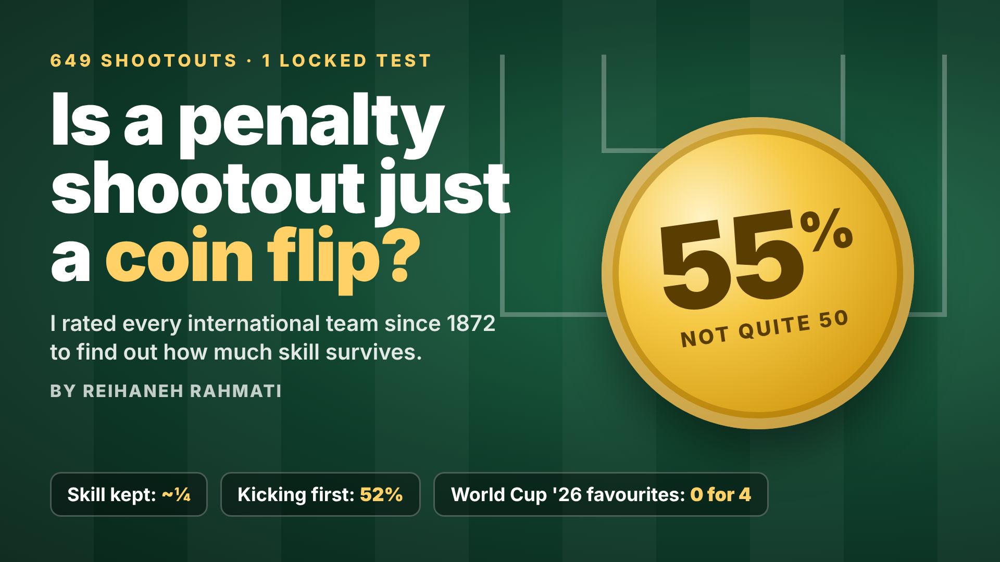

# Is a penalty shootout just a coin flip?

**Live site: https://reihooneh.github.io/probability-for-ai/**

Final project for *Probability for AI* by Reihaneh Rahmati.

At the 2026 World Cup the favourite lost all four penalty shootouts. I rated every national team since 1872, checked 612 real shootouts and built an exact kick-by-kick model to find out how much skill survives the penalty spot.

**Short answer:** the better team wins about 55% of shootouts. A shootout keeps about a quarter of the skill gap a normal match has, and kicking first gives no real edge (52%). On a locked test set (2025–26) the model tied a fair coin.

## What's on the site
- **3D shootout:** watch the kick-by-kick model play out in a 3D stadium
- **3D probability:** rotate the exact win-probability surface for every pair of kickers
- **Team explorer:** compare any two national teams in a match and in a shootout
- **The data**, **The maths** and **Honest bits** (the locked test set and what didn't work)

## Files
- `index.html`: the built site (served by GitHub Pages)
- `app/`: the React source (`App.tsx`, `Pitch3D.tsx`, `Surface3D.tsx`, `model.ts`, `site.css`, `data.json`)

Data: M. Jürisoo, *International football results from 1872*, https://github.com/martj42/international_results (CC0).
